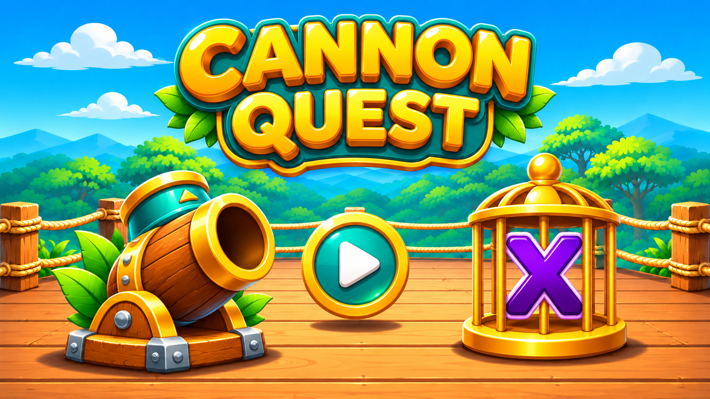

<div align="center">

# 💥 Cannon Quest

**Load operation orbs into a cannon, fire at the equation, and free x from its cage.**

[](https://cannon-quest.vercel.app)




</div>

## About

Cannon Quest is a 2D algebra game about solving linear equations. A purple **x** is locked in a
golden cage, inside an equation such as **x + 5 = 7**. The player loads operation orbs (+5, −5, ×3,
÷3 …) into a cannon and fires. Each shot applies its operation to **both whole sides** of the
equation, and when x stands alone the cage bursts open. It is designed for learners aged about
11–15. The learning goal is simple: whatever you do to one side, you do to the other, and you
undo operations in reverse order to isolate x.

## Highlights

- **Six rounds, easy to hard:** one step (x + 5 = 7, 3x = 18), two steps (2x + 3 = 11,
  x/3 + 2 = 6), then a challenge (2x + 7 = 1, 3(x + 2) = 21)
- **Real algebra on screen.** Each orb splits into two identical terms that land on both sides,
  cancelling terms vanish, and bracket steps are shown simplified. Exact fractions and negatives
  are used, and any route that isolates x is accepted
- **Orbs colour-coded by operation:** + orange, − cyan, × green, ÷ violet, with high-contrast labels
- **Gentle feedback.** A miss is never called "wrong". The first miss gets a retry, and a second
  miss shows the solution step by step
- **A big win moment.** The cage cracks slowly, x bursts out and dances, and the cloud explodes into
  puffs before the next equation forms
- **Spotlight tutorial** on the first screen (equation, cannon, orbs, tap −5, tap FIRE), with a
  hand to show each step and an idle hint after a few seconds
- **Recorded voice-over** with captions that appear word by word, plus recorded CC0 sound effects
  and background music
- **Game feel:** camera lean-ins, screen shake and cannon-blast particles, all built from GSAP
  timelines. Reduced-motion is supported, and slower devices automatically get fewer particles
- **Works offline** from `index.html`, with fonts and sound effects embedded. Every string is
  looked up by key, so the game is ready for translation (`?lan=xx`)

## How to play

1. Press **Play** and read the equation on the cloud.
2. Tap or drag an orb from the tray into the cannon. Two-socket cannons take two orbs, fired in order.
3. Tap **FIRE**. The orb's operation is applied to both sides of the equation.
4. Get **x** alone to free it from the cage. After six rounds, the quest is complete.

Keyboard: `1`–`8` load an orb, `Backspace` removes the last one, `Enter` fires.

## Tech stack

- **HTML5, CSS3 and vanilla JavaScript**, written as source files in `src/` and joined by `build.sh`
- **GSAP 3.15.0**, bundled locally in `libs/` for all animation
- **Web Audio** playback of Opus (`.webm`) sound effects, music and voice clips
- **WebP** sprites and a key-based i18n layer (`js/i18n.js`, `locales/locales.json`)
- **Tooling:** Node.js for the build, and Python (Pillow, NumPy, SciPy, OpenCV) with FFmpeg for
  cutting art, voice clips and music

## Run locally

```bash
git clone https://github.com/aniketchauhan-star/cannon-quest.git
cd cannon-quest
npx serve .
```

Then open the address it prints, or simply double-click `index.html`. The game is already built.
After editing anything in `src/` or `locales/locales.json`, rebuild with:

```bash
./build.sh
```

## Project structure

```
cannon-quest/
├── index.html      # the built game page (open this to play)
├── js/             # built game script, embedded sound effects, i18n helper
├── libs/           # GSAP, bundled locally
├── locales/        # every on-screen and spoken line, by key (English)
├── assets/         # sprites (WebP), sound effects, music, voice clips and fonts
├── src/            # game source; build.sh joins it into index.html and js/script.js
├── tools/          # scripts that cut sprites, voice clips and the music loop
├── art/            # source art sheets and mockups (not loaded by the game)
├── docs/           # voice-over scripts, design review notes, developer notes
├── build.sh        # rebuilds the game from src/ and locales/
└── CREDITS.md      # music, sound effect, font and library credits
```

For the full behaviour of every screen, editing tables and asset pipelines, see
[docs/DEVELOPER-NOTES.md](docs/DEVELOPER-NOTES.md). The design review and what changed for each
point are in [docs/DESIGN_REVIEW.md](docs/DESIGN_REVIEW.md).

## Credits

- Design & development: **Aniket Chauhan**, UI/UX Designer & Developer
- Design review feedback: Karan
- Music: "War on Water: Chapter 1" by yd (CC0), mixed with CC0 nature and cannon recordings by
  Joseph Sardin (BigSoundBank)
- Sound effects: CC0 and public-domain recordings from Kenney, rubberduck, BigSoundBank and
  Wikimedia Commons
- Fonts: Poppins and Trig Text (SIL Open Font License), Swifty Math (GUST Font License)
- Animation: GSAP by GreenSock

Full sources and licences are listed in [CREDITS.md](CREDITS.md).
